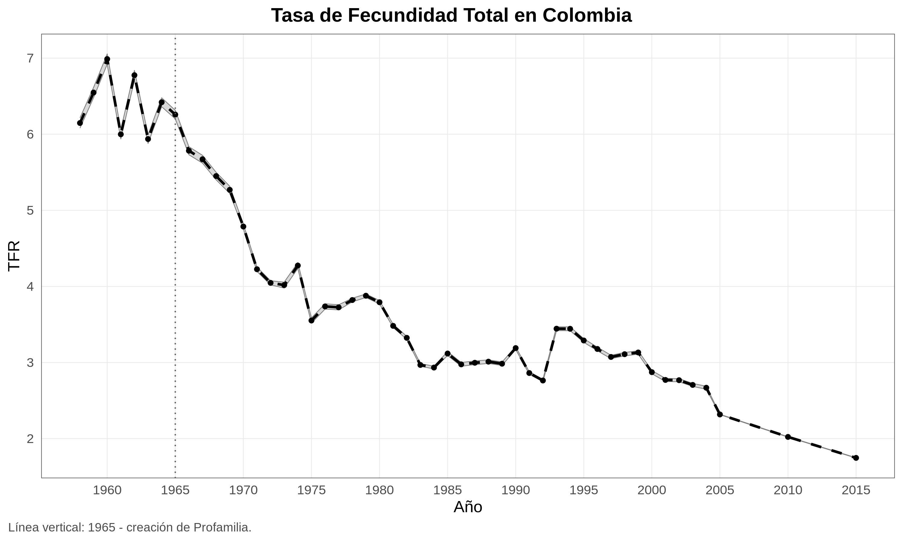
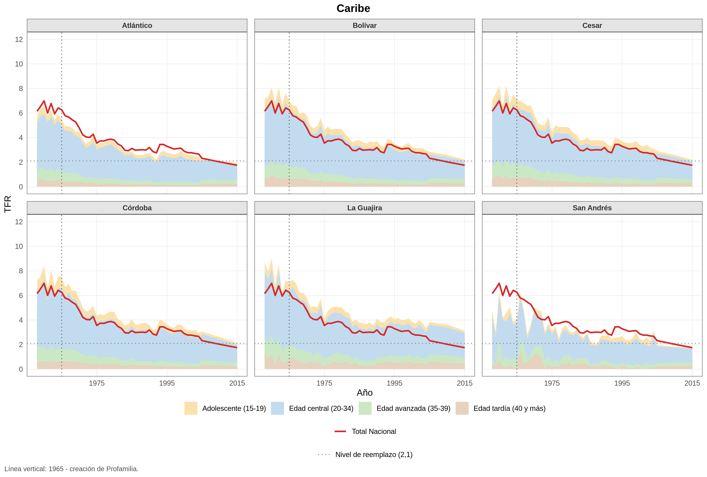
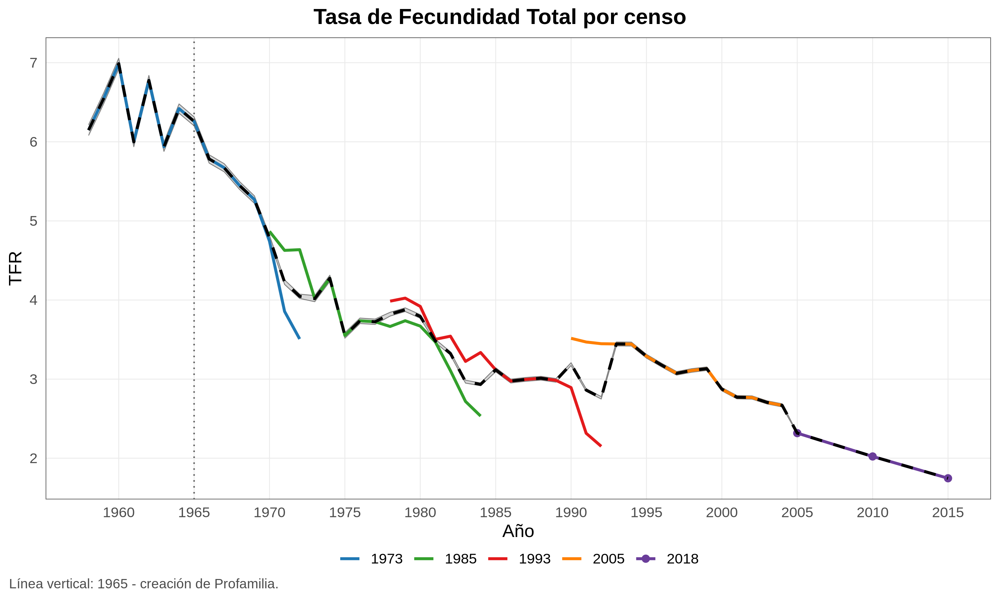
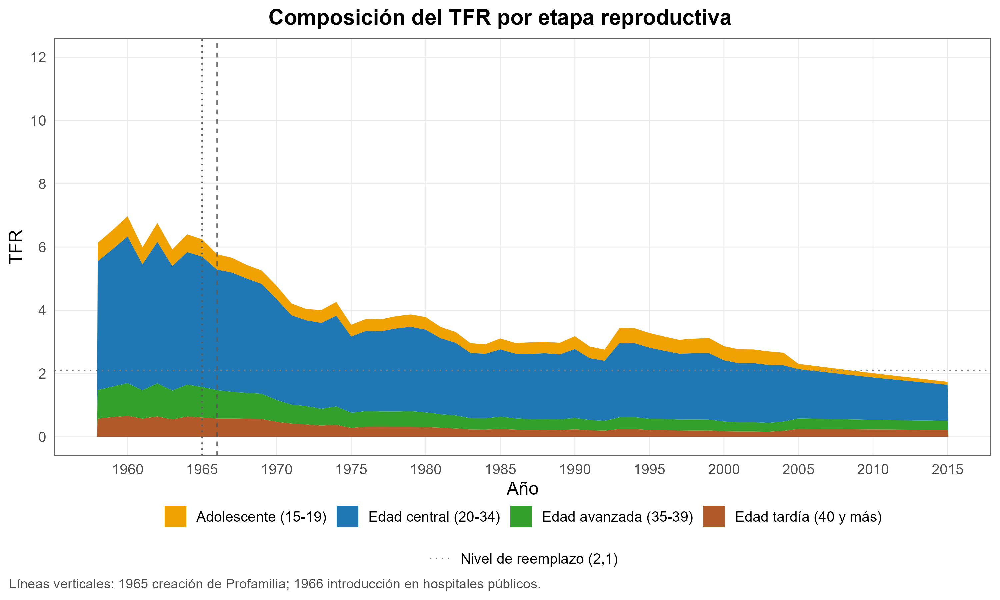
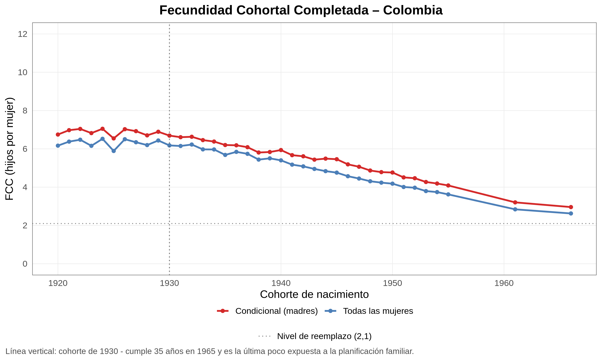
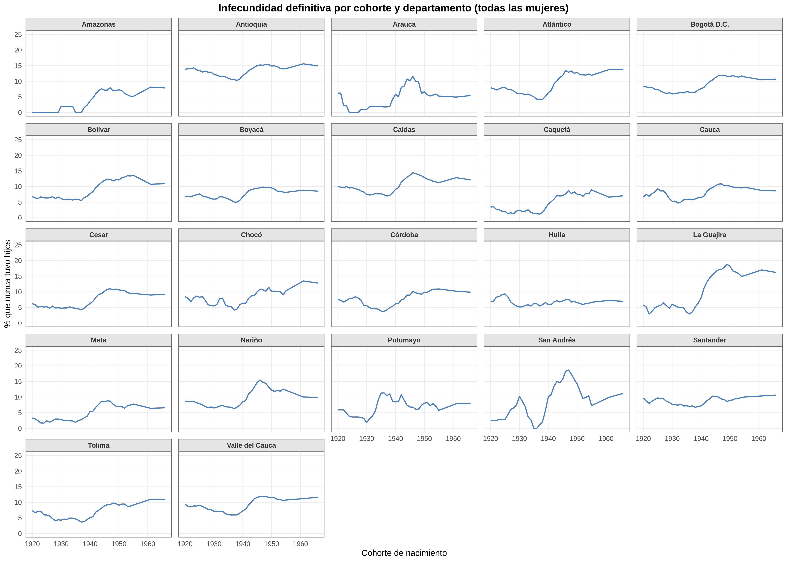
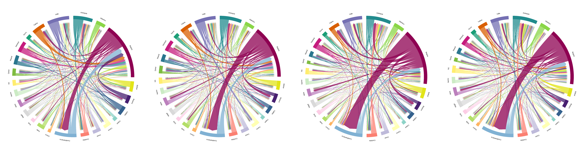

# Decisiones metodológicas

Este documento reúne las decisiones que hay detrás de los resultados: qué se mide, con qué fuente, qué supuestos se hacen y qué limitaciones quedan. La descripción de cada script y el orden de ejecución están en `R/README.md`; la obtención de los datos, en `data/README.md`.

Las figuras que se citan son las que ya producen los scripts (`output/graficas/`); hay que correr el proyecto antes para que se vean.

## 1. Fecundidad

### 1.1 Fuentes, unidad geográfica y regiones

- Los departamentos siguen las agrupaciones de IPUMS (por ejemplo, Bogotá D.C. incluye Cundinamarca); ver el diccionario en `00_setup.R`.
- Las 22 agrupaciones se reparten en cinco regiones (`region_de_departamento` en `00_setup.R`), partiendo de las regiones naturales del DANE con tres ajustes: Orinoquía y Amazonía se unen, San Andrés se integra al Caribe por ser la única insular, y la región Andina se divide en central y oriental para que ningún grupo concentre la mitad de los departamentos. Cada agrupación se asigna según el departamento que le da nombre. Quedan así: Caribe (6), Andina central (4), Andina oriental (3), Pacífica (4) y Orinoquía y Amazonía (5).
- Las figuras regionales no agregan los departamentos en una sola serie: `por_region()` (en `00_setup.R`) recorre las cinco regiones y arma una figura por cada una, con un panel por departamento. Así se comparan los departamentos de una misma región sin promediar series de tamaños muy distintos.
- En el censo 2018 la edad es quinquenal (se usa el punto medio entero del intervalo) y el vínculo madre-hijo se imputa con reglas de parentesco, por lo que sus estimaciones no son estrictamente comparables con las de los censos IPUMS.
- Las figuras combinan las dos fuentes. En el TFR, los censos IPUMS cubren hasta 2004 y el CNPV 2018 extiende la serie hasta 2015; en la FCC, IPUMS llega a la cohorte 1955 y el CNPV 2018 hasta 1966. Como el censo 2018 reporta la edad en grupos quinquenales, sus puntos van de cinco en cinco y se ven espaciados al final de cada serie. Las tablas se mantienen separadas por fuente; la unión se hace solo al graficar, con una columna `fuente` que indica el origen de cada punto.

*La serie nacional final: censos IPUMS año a año hasta 2004 y CNPV 2018 en puntos quinquenales (2005, 2010, 2015). Producida por `09_figuras_tfr_fcc.R`.*

*Cómo se ven las figuras regionales: un panel por departamento, sin agregar la región en una sola serie. Las otras cuatro regiones están en la misma carpeta.*

- La línea "Total Nacional" de las figuras de TFR departamentales y regionales es la serie nacional (IPUMS más CNPV 2018), la misma de la figura nacional, que suma los conteos ajustados de todos los departamentos. No se usa el promedio simple de las TFR departamentales, porque daría el mismo peso a San Andrés que a Bogotá y sobrestimaría el nivel del país (hasta 7,7 en los años sesenta, frente a 7,0).

### 1.2 Método de hijos propios y TFR

- El método de hijos propios sigue a Reid et al. (2020), con ajustes por mortalidad infantil y materna (tablas de supervivencia) y por hijos no vinculados a su madre en el censo. El rango reproductivo considerado es 15-50 años.
- Las probabilidades de supervivencia se interpolan sobre la tabla (`interpolar_probsurv()`) en vez de cruzarse por coincidencia exacta de edad. Las tablas de los censos IPUMS vienen por edad simple, pero las del censo 2018 solo traen los puntos medios de los grupos quinquenales; con un cruce exacto, las edades que no coinciden quedarían sin probabilidad y anularían el denominador. En las tablas de edad simple la interpolación devuelve exactamente el mismo valor.
- El ajuste por mortalidad siempre se hace con la tabla de supervivencia del departamento correspondiente. Los resultados nacionales se obtienen sumando los nacimientos y las mujeres ya ajustados de los 22 departamentos, de modo que no se requiere una tabla de vida nacional.
- Cada censo aporta hasta 15 años de tasas retrospectivas, así que varios censos cubren los mismos años calendario. `aggregate_asfr_tfr()` suma los conteos ajustados de todos ellos y devuelve una sola serie por año. Con `by_census = TRUE` se obtiene la versión desagregada por censo, útil para comparar los tramos que se solapan; el script `01` la exporta en la hoja `TFR_por_censo`.
- Las series traen intervalo de confianza (`se_tfr`, `tfr_lower`, `tfr_upper`, y `se_asfr` en las ASFR), calculado tratando los nacimientos observados como Poisson y las mujeres como fijas. Es una cota inferior del error: no incorpora el conglomerado por hogar ni la incertidumbre de las tablas de supervivencia y del ajuste por hijos no vinculados. Para una medida más completa habría que hacer bootstrap por hogares.

*Traslape de las ventanas retrospectivas. Cada color es la serie que aporta un censo; la línea negra es la serie agregada que suma los conteos ajustados de todos los censos que cubren el año. Producida por `09_figuras_tfr_fcc.R` a partir de la hoja `TFR_por_censo` del script `01`.*

- **Limitaciones.** En los años traslapados los censos no coinciden: el censo más antiguo da valores más bajos en los últimos años de su ventana (el de 1973 cae a 3,5 en 1972; el de 1985 a 2,5 en 1984; el de 1993 a 2,1 en 1992), mientras que el censo siguiente da valores más altos para esos mismos años. Como la serie agregada suma los conteos, hereda parte de esa caída y muestra saltos en las uniones: el más visible es el paso de 2,8 en 1992 a 3,4 en 1993, que corresponde al cambio de censo y no a un repunte de la fecundidad. 

### 1.3 Descomposición del TFR por edad de la madre

- La descomposición del TFR suma las tasas específicas dentro de cada tramo de edad: adolescente (15-19), edad central (20-34), edad avanzada (35-39) y edad tardía (40 y más). Como el TFR es la suma de las tasas, el alto total del área apilada es el TFR del año. Sale en nivel y en participación porcentual: para el país, para cada departamento y, en `regional/`, una figura por región con un panel por departamento. En la versión en nivel la leyenda va en dos filas: las cuatro etapas arriba y el nivel de reemplazo debajo.
- Las figuras del script `08` también combinan las dos fuentes. El ASFR del censo 2018 ya viene en la escala correcta: su suma reproduce el TFR del año, así que no se reescala. Lo que sí cambia es el detalle, porque ese censo solo reporta edades de la madre en múltiplos de cinco: los perfiles por edad de esos años tienen menos puntos y la composición por tramos es más gruesa.
- Antes de descomponer, el ASFR se consolida a una sola fila por año y edad. Si la tabla viene desagregada (por ejemplo por censo), las tasas no se suman ni se promedian: se reagregan desde los totales, como total de hijos sobre total de mujeres. Sin esa consolidación, las áreas apiladas se dibujan superpuestas y la composición aparenta pasar del 100%.

*El alto del área apilada es el TFR del año. Producida por `08_indicadores_asfr.R`; la versión en participación porcentual es `TFR_ASFR_descomposicion_nacional_pct.png`.*

- **Discontinuidad de fuente en 2005.** En el paso de los censos IPUMS (hasta 2004) al CNPV 2018 (desde 2005) cambia la composición por edad, no solo el nivel. Es consistente con que el censo 2018 solo reporte la edad de la madre en grupos quinquenales, así que conviene no interpretar el cambio de composición entre 2004 y 2005 como un hecho demográfico.

### 1.4 Fecundidad cohortal completada e infecundidad

- En la FCC, las mujeres sin información de hijos nacidos vivos se excluyen del cálculo y cada script reporta cuántas fueron.
- En el censo 2018 el número de hijos se arma con dos variables: `pa_hnv` indica si la mujer ha tenido hijos nacidos vivos y `pa1_thnv` el total, que solo se registra a quienes responden que sí. Las que declaran no haber tenido cuentan como cero; tratarlas como dato faltante eliminaría justamente a las mujeres sin hijos, subiría la FCC y dejaría la infecundidad en cero.
- La infecundidad definitiva se mide entre mujeres que ya completaron su vida fértil (50 años o más): es la proporción que nunca tuvo hijos, derivada de las tablas de FCC como `(women - mothers) / women`. Es la única medida de infecundidad que se grafica. Se produce en dos versiones: entre **todas** las mujeres (archivos `SinHijos_cohortal_*`) y entre las **alguna vez casadas o unidas** (archivos `SinHijos_cohortal_casadas_*`), es decir todo estado civil que no sea soltera. El estado civil viene de `MARST` en IPUMS (categorías 2-4) y de `p_est_civil` en el Censo 2018 (categorías 1-6); esta última exige reconstruir el parquet con `aux_build_cnpv2018_parquet.R` antes de correr `05`, `06` y `09`. El % sin hijos de 15 a 54 años sigue en las tablas de `05` y `06`, pero no se grafica: mezcla mujeres que todavía pueden tener hijos, así que sus cambios reflejan tanto el aplazamiento como la infecundidad y no se pueden separar.
- Las figuras de infecundidad combinan las dos fuentes, pero la suavización se aplica solo a los censos IPUMS, que dan una cohorte por año: se usa una media móvil centrada de cinco cohortes (`pct_suave`), porque en cohortes con pocas mujeres el porcentaje salta e incluso llega a cero por falta de observaciones. El CNPV 2018 aporta cohortes de cinco en cinco, así que promediar cinco de ellas abarcaría veinticinco años y sus valores se dejan como están. Las figuras dibujan una sola línea continua con las dos fuentes juntas, sin distinguirlas; los datos crudos por cohorte y su origen quedan en las tablas de `output/tablas/`.

*FCC entre todas las mujeres y entre las madres (condicional), desde la cohorte 1920. Los dos últimos puntos (1961 y 1966) vienen del CNPV 2018. Producida por `09_figuras_tfr_fcc.R`.*

*Infecundidad definitiva por cohorte, todas las mujeres. Ilustra por qué se suaviza la serie IPUMS: aun con la media móvil, los departamentos pequeños (Amazonas, Arauca, San Andrés) llegan a cero o saltan varios puntos entre cohortes vecinas. La versión entre alguna vez casadas o unidas es `SinHijos_cohortal_casadas_panel.png`.*

## 2. Migración interna

### 2.1 Punto de partida: réplica de Acosta y Gu (2022)

- El módulo replica los flujos interdepartamentales de Acosta y Gu (2022, DTSERU 304) para 2012 y 2019 y los extiende a 2022 y 2024. Se mantienen sus definiciones, su universo y su unidad de medida para que los cuatro años sean comparables con el documento original.
- La réplica se verifica contra los flujos originales de 2019 a 5 años (`data/GEIH_migracion/referencia/flows_5y_2019_AcostaGu.csv`). El script `11` reporta la correlación, el total y la diferencia absoluta media, y guarda la comparación celda a celda en `output/tablas/migracion/replica_flows_5y_2019_vs_AcostaGu.csv`.

- Figura de referencia para la réplica: `output/graficas/migracion/chord_5y_2019.png`, comparable con la figura 3 del documento original.

### 2.2 Fuente: GEIH del DANE

- 2012 y 2019 usan el Módulo de Migración de la GEIH (un ZIP por mes). 2022 y 2024 usan la GEIH marco 2018 completa, que trae el capítulo de migración dentro de la encuesta mensual.
- El módulo de migración de 2012 y 2019 no trae el departamento de residencia. Se toma de Características generales del Empalme del mismo año, uniendo por `DIRECTORIO`, `SECUENCIA_P`, `ORDEN` y mes. El script reporta el porcentaje de personas del módulo que encuentran pareja en el Empalme.
- El módulo de 2012 no tiene enero (el DANE no lo publica), así que el promedio de ese año es sobre 11 meses.

### 2.3 Quién es migrante

Una persona es migrante si su departamento de residencia actual (destino) difiere del de referencia (origen). El destino es el departamento donde se hace la encuesta (`DPTO`).

| Año | Migrante a 5 años | Migrante a 1 año |
|---|---|---|
| 2012 | `P6074 = 2`, `P6075 <= 5`, `P6076 = 2`; origen `P6076S1` | `P6074 = 2`, `P6075 = 1`, `P6076 = 2`; origen `P6076S1` |
| 2019 | `P755 = 3`; origen `P755S1` | `P753 = 3`; origen `P753S1` |
| 2022, 2024 | `P3382 = 3`; origen `P3382S1` | `P3384 = 3`; origen `P3384S1` |

- En 2019, 2022 y 2024 la pregunta es directa: dónde vivía hace 5 años y hace 12 meses.
- 2012 no pregunta dónde vivía hace 5 años. Como en el documento original, el migrante se reconstruye con los años que lleva en el municipio: no siempre ha vivido ahí, llegó hace 5 años o menos y antes vivía en otro municipio de Colombia; el origen es ese municipio anterior. Esto mide la última mudanza y no la residencia en una fecha fija, así que 2012 no es estrictamente comparable con los otros años: deja por fuera a quien se fue y volvió dentro de la ventana, y asigna el origen de la última mudanza aunque haya habido varias.
- Solo cuentan los movimientos entre departamentos: los cambios de municipio dentro del mismo departamento no son migración en esta medida.

### 2.4 Universo

- Los 24 departamentos donde la GEIH es representativa en todo el período (23 departamentos más Bogotá), en sistema cerrado, como en el documento original. Se descartan los flujos con origen o destino fuera de ese grupo (incluidos los internacionales), así que el total de emigrantes es igual al de inmigrantes.
- A diferencia del módulo de fecundidad, que usa las 22 agrupaciones de IPUMS, aquí se trabaja con departamentos DANE individuales. Las regiones son las mismas de `00_setup.R`, asignadas a nivel de departamento; Norte de Santander va con Andina oriental (en IPUMS se agrupa con Cesar).
- Las matrices son completas (24 × 23): los pares sin observaciones quedan en cero en vez de faltar, para que todas tengan la misma forma.

### 2.5 Unidad y factores de expansión

- El valor anual es el promedio mensual de la población expandida, en miles de personas (`val`). Cada mes de la GEIH se expande a la población total, así que promediar los meses da una estimación anual y no una suma de doce poblaciones.
- Se calculan dos versiones según el factor de expansión:
  - **CNPV 2018** (`FEX_C` del Empalme para 2012 y 2019, `FEX_C18` para 2022 y 2024). Es la versión principal: los cuatro años quedan con la misma base poblacional y son comparables. Archivos `flows_{5y|1y}_{año}.csv`.
  - **CNPV 2005** (`fex_c_2011`), el factor que usan Acosta y Gu. Solo existe para 2012 y 2019 y sirve para la réplica. Archivos `flows_{5y|1y}_{año}_fex2011.csv`.
- Las tasas por departamento (emigración, inmigración y neta) son por mil habitantes, con la población expandida de la misma encuesta y el mismo factor, para que numerador y denominador sean consistentes.

### 2.6 Diagramas de cuerdas

- Adaptan el código de Karina Acosta (2024) que produce las figuras 3 y 4 de Acosta y Gu, con los mismos parámetros gráficos.
- Los colores se asignan por nombre de departamento y no por posición, para que cada departamento conserve su color en todos los años.
- Hay una versión regional que ordena los sectores por región y colorea cada departamento con el color de su región, y un panel con los cuatro años a 5 años lado a lado, como la figura 4 del documento.

*Flujos a 5 años de los cuatro años, un color por departamento (`12_figuras_migracion_chord.R`). Cada año también tiene su diagrama individual, a 5 años y a 1 año, en la misma carpeta.*

### 2.7 Limitaciones conocidas

- **La réplica de 2019 reproduce la estructura pero no el nivel.** En la última corrida, los flujos a 5 años de 2019 con `fex_c_2011` tienen una correlación de 0,99 con los originales, pero suman 2.868 mil migrantes frente a 3.225 mil de Acosta y Gu (unos 11% menos). Los flujos grandes coinciden y el 84% de los pares difiere en menos de mil personas; la brecha está repartida en flujos pequeños, y Cundinamarca como destino concentra cerca de un tercio (por ejemplo, Chocó a Cundinamarca: 25,0 mil en el original frente a 2,1 mil). Falta identificar su origen (los meses incluidos, el emparejamiento con el Empalme, la codificación de Cundinamarca y Bogotá o algún filtro adicional del documento original) antes de presentar los niveles de 2012 y 2019 como réplica exacta. La comparación celda a celda está en `output/tablas/migracion/replica_flows_5y_2019_vs_AcostaGu.csv`.
- **Cambio de cuestionario.** 2012 usa una definición indirecta (sección 2.3), 2019 el módulo de migración y 2022 y 2024 la GEIH marco 2018. Parte de los cambios entre años puede venir del instrumento y no solo del comportamiento migratorio.
- **Totales nacionales con el factor CNPV 2018** (miles, sistema cerrado): a 5 años, 3.039 (2012), 2.798 (2019), 2.395 (2022) y 2.612 (2024); a 1 año, 1.027, 1.018, 699 y 757. La caída de 2022 coincide con el cambio de marco y con el período pospandemia, así que conviene leerla con cuidado.
- **Error muestral.** Los flujos son estimaciones puntuales sin intervalo de confianza. Muchos pares de departamentos pequeños se apoyan en muy pocas observaciones, así que los flujos chicos de las matrices son ruidosos.
